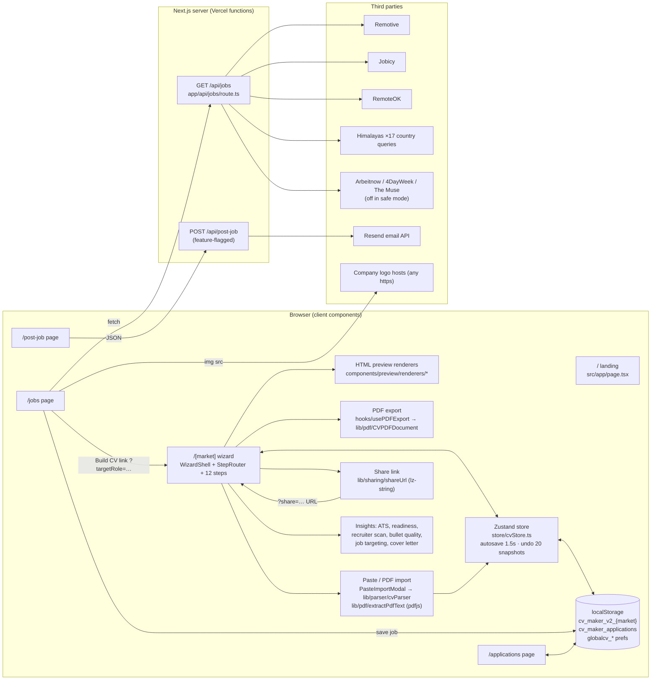
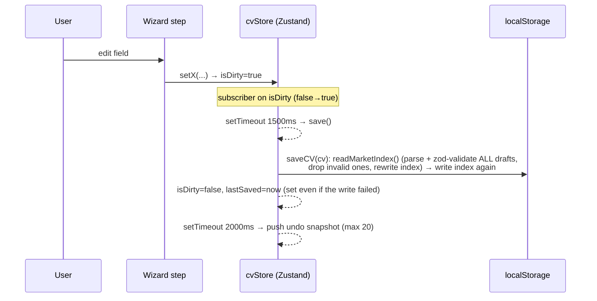
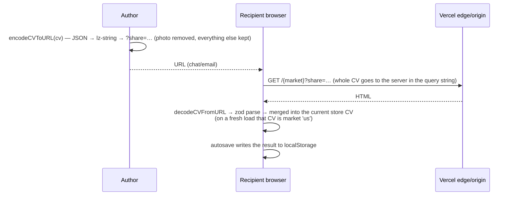

# GlobalCV — System Architecture (as built)

*Audit date: 2026-10-24 · Commit audited: `9dbaf3f` · Branch: `claude/awesome-einstein-7cofem`*

This document describes the architecture that actually exists in the repository, not the one described in the README. Where they differ, it says so.

## 1. Purpose and users

GlobalCV is a free CV and résumé builder that runs in the browser. It produces documents that follow the conventions of 8 job markets (US, GB, AU/NZ, IN, EU, LATAM, BR, JP: Rirekisho and Shokumu-keirekisho). The intended users are job seekers, often applying across borders. Secondary features:

- **Jobs board** (`/jobs`): a feed of remote jobs pulled server-side from public job APIs.
- **Application tracker** (`/applications`): a list of saved jobs and their status, kept in localStorage.
- **Remote-workers guide** (`/remote-workers`): static content plus a "remote work profile" on the CV.
- **Post-a-job form** (`/post-job` → `/api/post-job`): disabled by default. When enabled, it sends an email through Resend.

There are no user accounts, no database and no server-side persistence of CV data.

## 2. Technology stack

| Layer | Technology (installed version) |
|---|---|
| Framework | Next.js 16.2.0 (App Router, Turbopack) |
| UI | React 19.2.4, Tailwind CSS 3.4, Radix UI primitives, lucide-react |
| State | Zustand 4.5 + Immer 11 (`subscribeWithSelector`) |
| Forms | react-hook-form 7 |
| Validation | zod 3.25 (CV schema, post-job payload) |
| PDF generation | @react-pdf/renderer 4.3.2 (main thread, lazy-loaded) |
| PDF import | pdfjs-dist 5.7.284 (worker served from `/public/pdf.worker.min.mjs`) |
| Share links | lz-string |
| QR codes | qrcode |
| Email | resend 6.9.4 (post-job only) |
| Hosting | Vercel (per README and the privacy policy; there is no IaC in the repo) |
| CI | One GitHub Actions workflow (`mirror.yml`) that only force-pushes `main` to a mirror |

## 3. Component map

### Main modules

| Module | Responsibility | Size |
|---|---|---|
| `src/types/cv.types.ts`, `src/lib/cv/schema.ts` | Shared `CVData` model and the zod schema used for share links, JSON restore and storage migration | 177 + 186 lines |
| `src/lib/markets/*.config.ts`, `src/types/market.types.ts` | Per-market config: field visibility, sections, templates, labels, page size. This is the "config-over-code" core | ~2k lines total |
| `src/store/cvStore.ts` | All CV mutations, autosave, undo/redo, privacy mode | 822 lines |
| `src/lib/storage/localStorage.ts` | Versioned draft index per market, legacy migration, application tracker | 311 lines |
| `src/lib/pdf/CVPDFDocument.tsx` | Every PDF layout for every market, in one file | 1,232 lines |
| `src/components/preview/renderers/*` | HTML preview layouts. A second implementation of each template, parallel to the PDF one | 8 files |
| `src/lib/parser/cvParser.ts` | Heuristic parser for pasted text, Markdown or PDF text | 637 lines |
| `src/app/api/jobs/route.ts` | Aggregation, normalisation, dedup, filtering and pagination of jobs | 891 lines |

## 4. Key data flows

### 4.1 Editing and autosave

Every save re-reads, re-validates and rewrites the whole market index, twice. Drafts that fail validation are removed during that pass. See finding P0-2 in the audit report.

### 4.2 Share link

### 4.3 Jobs board

`GET /api/jobs` fans out to up to ~20 upstream HTTP requests: Remotive 1, Jobicy 1, RemoteOK 1, Himalayas 6 LATAM + 10 EMEA + 1 JP. It waits for all of them with an 8 s timeout each, then normalises, de-duplicates by `title|company`, filters, sorts and returns 20 per page. Upstream responses are cached by Next's data cache (`revalidate: 300`), keyed by URL. Any request with a free-text `q` produces new upstream URLs, so it is not cached. Upstream errors are swallowed and become empty arrays.

### 4.4 PDF export

`usePDFExport` dynamically imports `@react-pdf/renderer` (a lazy 1.5 MB chunk), the PDF document and optionally `qrcode`. It renders on the **main thread**. The README says it runs in a Web Worker, which is incorrect. It then downloads a Blob. Japanese layouts register the self-hosted Noto Sans JP fonts (2 × 2.3 MB TTF).

### 4.5 Import

- **Paste/PDF**: `extractTextFromPdf` (pdfjs `getDocument` + `getTextContent`) → `parseCVInput` → preview → selective apply.
- **JSON restore**: `FileReader` → `parseCVData` → `restoreCV`. There is no market check, and errors are dropped silently.

## 5. Deployment

- The intended target is Vercel's zero-config Next.js deployment. `next build` succeeds and produces 9 static routes plus `/[market]`, `/api/jobs` and `/api/post-job` as dynamic functions.
- Configuration is through environment variables only: feature flags for post-job and job sources, `RESEND_*`, and the brand logo. See `.env.example`.
- Security headers are set globally in `next.config.mjs`.
- The repo contains no IaC, Dockerfile, preview/staging definition, health endpoint, monitoring or rollback documentation.
- The only workflow is `.github/workflows/mirror.yml`, which force-pushes `main` to `git@github.com:augustosc-eu/globalcv.git`. That is the repository the workflow itself lives in.

## 6. Maturity assessment

This is an early-stage product (v0.1.0, 35 commits between 2026-03-18 and 2026-06-07). It has a lot of features and a careful domain model for market conventions. Engineering safeguards are thin: no automated tests, no lint config, no CI quality gate, no monitoring. The client-only design keeps the attack surface small. The risk sits in data integrity in localStorage, in how share links handle privacy, and in the server-side jobs aggregator.

## 7. Architectural pressure points as the project grows

1. **Two template implementations** (HTML preview renderers and react-pdf layouts) must stay visually in sync by hand. Every new template costs double, and drift is likely.
2. **`CVData` is one flat union of every market's fields.** The market list is hard-coded in 5 places: `schema.ts:4`, `markets/index.ts:28`, `localStorage.ts:220`, `[market]/layout.tsx:7`, `CopyToMarketModal.tsx:18`.
3. **localStorage as the only database.** There is a ~5 MB quota, base64 photos are stored per draft, every write rewrites the whole index, and there is no cross-tab locking.
4. **The jobs aggregator is a single 891-line route.** It holds three near-identical Himalayas fetchers and has no per-source health, budget or rate limiting.
5. **Version-coupled storage schema.** zod validation on read deletes data that does not match. Any future schema tightening deletes users' drafts unless migrations are written first.
